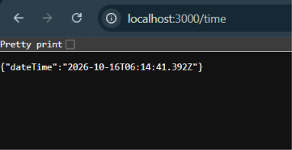

# Lab 1: Node.js and Express Server

**Subject:** Backend Development Fundamentals  
**Year/Term:** Year II, Term II  
**University:** Aurora Deemed to be University  
**Faculty:** Mr. Joel Prashanth D

## Student Details

| Field | Details |
|---|---|
| Name | Shanmuk Shahith |
| Registration Number | 252U1R9137 |
| Section | CSE - GEN-AI - 2C |

## Project Objective

This lab demonstrates the fundamentals of creating and running a Node.js backend server using the built-in HTTP module and Express.js. It covers project initialization with npm, dependency installation, server setup, route handling, JSON responses, date and time generation, HTTP status codes, and handling unknown routes.

## Technologies Used

- Node.js
- Express.js
- npm (Node Package Manager)
- JavaScript (CommonJS)
- HTTP and JSON response handling

## Project Folder Structure

```text
lab-01/
├── app.js
├── server.js
├── package.json
├── package-lock.json
├── README.md
├── .gitignore
└── screenshots/
    ├── home.png
    ├── about.png
    ├── time.png
    └── 404.png
```

The `screenshots/` directory contains the screenshots of the tested endpoints. The `.gitignore` file excludes dependencies and environment-specific secrets.

## Installation and Execution

### Prerequisites

- Node.js and npm installed on the computer.
- Visual Studio Code or another code editor.

### Install Dependencies

1. Open a terminal in the project directory.
2. Initialize the project if it has not already been initialized:

   ```bash
   npm init -y
   ```

3. Install Express.js:

   ```bash
   npm install express
   ```

### Run the Basic Node.js HTTP Server

Execute:

```bash
node server.js
```

Open the following URL in your browser:

`http://localhost:3000`

The server responds with `Hello`.

Stop the server using `Ctrl + C` before starting the Express server.

### Run the Express Server

Execute:

```bash
node app.js
```

The Express application listens on port 3000.

Stop the server using `Ctrl + C`.

## Endpoints

| HTTP Method | Path | Description | Expected Status Code |
|---|---|---|---:|
| GET | `/` | Returns a welcome message | 200 |
| GET | `/about` | Returns the student's name and section in JSON format | 200 |
| GET | `/time` | Returns the current date and time using `new Date()` | 200 |
| Any | Any unknown path | Returns a Page Not Found message | 404 |

### Example Requests

- Home: `http://localhost:3000/`
- About: `http://localhost:3000/about`
- Time: `http://localhost:3000/time`
- Unknown route: `http://localhost:3000/unknown`

## Screenshots

The following screenshots demonstrate the successful execution of the application and its HTTP endpoints.

### 1. Home Route


### 2. About Route


### 3. Time Route



### 4. Unknown Route — 404 Not Found


## Problems Faced and Solutions

| Problem | Solution |
|---|---|
| Initializing a Node.js project | Used `npm init -y` to create `package.json`. |
| Express was not available by default | Installed Express.js using `npm install express`. |
| Returning different response formats | Used `res.send()` for text and `res.json()` for JSON responses. |
| Handling unknown routes | Added a final Express middleware that returns HTTP status code 404. |
| Running multiple servers on the same port | Stopped the running server before starting another server on port 3000. |

## Learning Outcomes

- Created and initialized a Node.js project using npm.
- Understood the purpose of `package.json`, `package-lock.json`, and `node_modules/`.
- Created a basic HTTP server using Node.js.
- Installed and used Express.js to build a backend server.
- Implemented GET routes using `app.get()`.
- Returned text and JSON responses.
- Generated the current date and time using `new Date()`.
- Handled unknown routes using HTTP status code 404.
- Tested endpoints and prepared project documentation for GitHub submission.

## Deployment

The application is currently running locally at `http://localhost:3000`.

After deploying the application to a Node.js-compatible hosting service, replace this section with the actual public URL. Configure the hosting service to install dependencies using `npm install` and start the application using `node app.js`, if `app.js` is the deployed entry point.

## Git Hygiene

The following entries should be included in the `.gitignore` file:

```gitignore
node_modules/
.env
```

Do not commit the `node_modules/` directory, environment files, API keys, passwords, or other sensitive credentials to GitHub.
